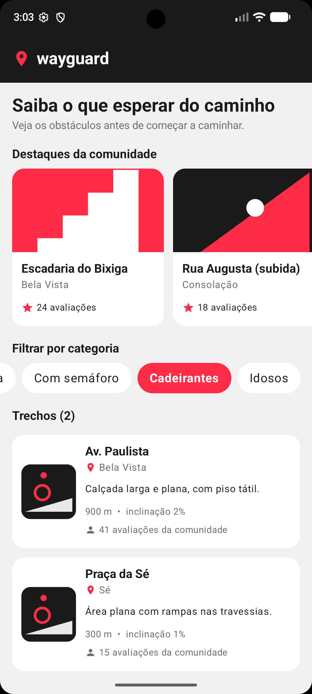

# WayGuard

> Saiba o que esperar do caminho antes mesmo de começar a percorrê-lo.

## Integrantes

| Nome completo                | RM       |
|------------------------------|----------|
| Alice Souza Galdino da Silva | RM561164 |
| Maria Clara Vieira da Silva  | RM560947 |
| Polianna Albuquerque Lima    | RM561078 |

## Tema da Global Solution

Mobilidade urbana e acessibilidade: tornar os trajetos a pé mais seguros, previsíveis e acessíveis para todas as pessoas, principalmente cadeirantes, idosos e pessoas com mobilidade reduzida.

## Descrição da solução

Os apps de mapa mostram distância e tempo, mas nem sempre mostram como é o caminho de verdade. O WayGuard é uma extensão para apps de mapa que mostra as condições dos trechos a pé (escadas, subidas, calçadas estreitas, semáforos) antes da pessoa sair de casa, para ela escolher a rota mais adequada para ela.

## Principais funcionalidades

- **Destaques da comunidade**: lista horizontal com os trechos mais avaliados pelos usuários.
- **Filtro por categoria**: lista horizontal de categorias (Todas, Escadas, Subidas, Calçada estreita, Com semáforo, Cadeirantes, Idosos). Ao tocar em uma categoria ela fica destacada em vermelho e a lista de trechos é atualizada na hora.
- **Lista de trechos**: lista vertical com o nome do trecho, imagem, bairro, descrição, distância, inclinação e número de avaliações da comunidade.

## Fluxo de telas

O app tem uma tela principal (`HomeScreen`):

1. O usuário abre o app e vê os destaques da comunidade.
2. Escolhe uma categoria no filtro (por exemplo "Cadeirantes").
3. A lista de trechos abaixo mostra apenas os trechos daquela categoria.
4. Tocando em "Todas" a lista volta a mostrar todos os trechos.

## Prints das telas

| Tela inicial | Filtro aplicado |
|---|---|
|  |  |

## Fonte dos dados

Os dados ficam em memória, dentro da classe `TrechoRepository` (não usa banco de dados nem API). Os trechos são de ruas de São Paulo, mas as informações (inclinação, avaliações etc.) são fictícias, apenas para demonstração.

## Arquitetura e organização dos packages

```
br.com.fiap.wayguard
├── MainActivity.kt           -> ponto de entrada, chama a HomeScreen
├── model
│   ├── Categoria.kt          -> enum class com as categorias
│   └── Trecho.kt             -> data class que representa um trecho
├── repository
│   └── TrechoRepository.kt   -> lista de trechos, destaques e filtro por categoria
├── components
│   ├── TrechoCard.kt         -> card da lista principal (vertical)
│   ├── CategoriaChip.kt      -> item de categoria selecionável
│   ├── DestaqueCard.kt       -> card da lista de destaques (horizontal)
│   └── TituloSecao.kt        -> título reutilizado nas seções
├── screens
│   └── HomeScreen.kt         -> tela principal (Scaffold, TopAppBar, listas)
└── ui.theme
    ├── Color.kt
    ├── Theme.kt
    └── Type.kt
```

- **model**: classes que representam os dados. Cada `Trecho` tem uma `List<Categoria>` (pode ter mais de uma categoria) e um `Boolean destaque`.
- **repository**: centraliza os dados e as regras de filtro (`getTrechos()`, `getDestaques()`, `getTrechosPorCategoria()`), assim os componentes só exibem as informações.
- **components**: composables reutilizáveis.
- **screens**: monta a tela usando os componentes. A categoria selecionada é guardada com `remember { mutableStateOf(Categoria.TODAS) }` e, quando muda, o Compose recompõe a lista automaticamente.

## Tecnologias

- Kotlin
- Jetpack Compose
- Material Design 3

## Video Pitch

https://youtu.be/AFdgiHxxvJY